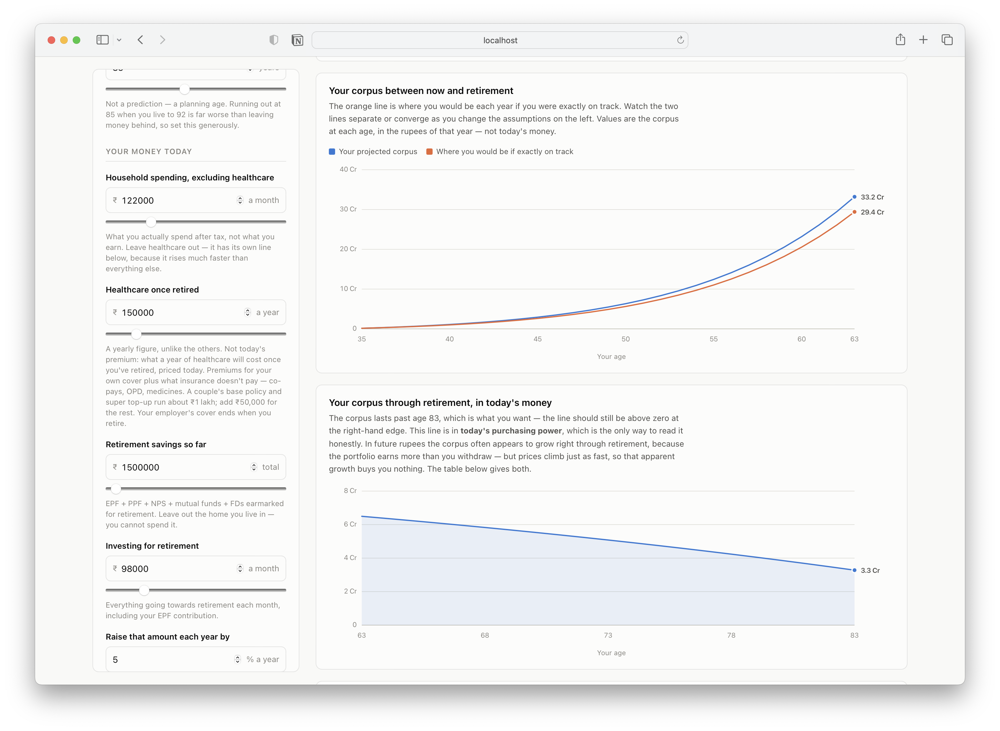
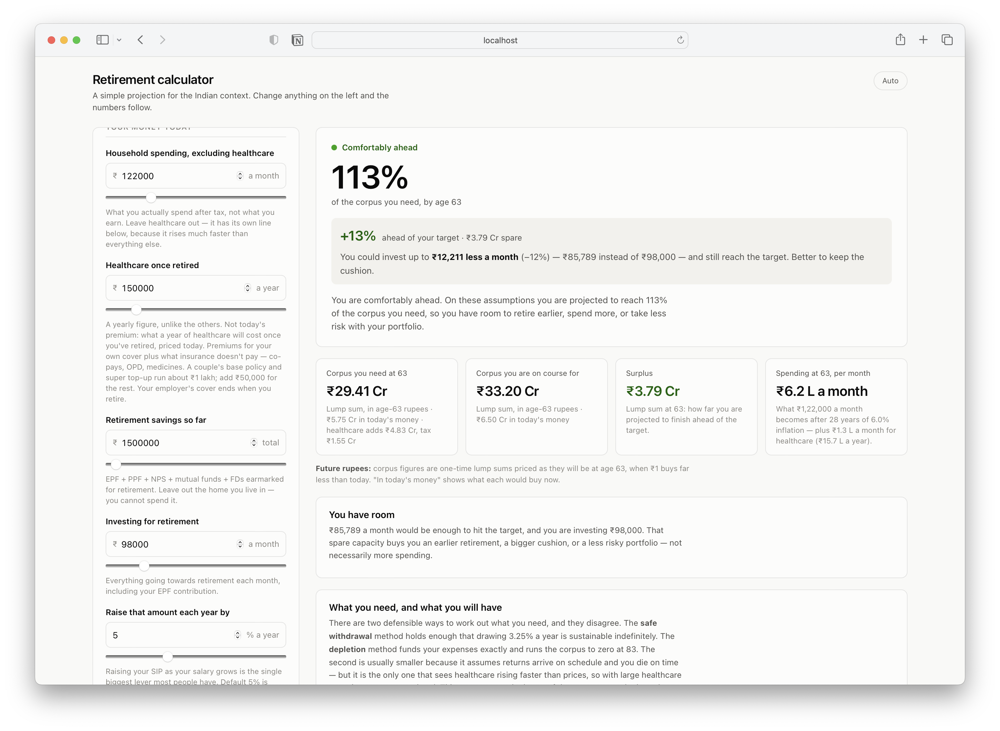
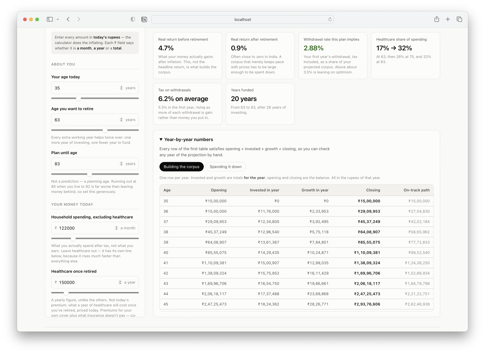

# Retirement calculator — India

A retirement corpus calculator for India that models inflation, healthcare costs and tax on withdrawals.
Built with a Haskell (Scotty) backend that does all the maths and a Svelte frontend that draws it.

## Features

- Required vs. projected corpus at retirement, with the monthly investment change needed to close the gap
- Healthcare on its own tapering inflation curve, plus age-related cost growth
- Tax on withdrawals estimated from the 2026-27 new-regime slabs (flat-rate and ignore modes available)
- Two corpus methods (spend-down to zero, and safe withdrawal rate); the larger one is used
- Live recalculation as you type; hand-rolled SVG charts with a year-by-year table

All arithmetic lives in the backend, so charts and figures always agree. The
server runs arithmetic self-checks on start-up and refuses to boot if any fail.

## Screenshots

**Summary** — how far ahead or behind you are, the corpus you need versus the one you're on course for, and how much you could change your monthly investment.



**Charts** — your projected corpus against the on-track path up to retirement, then the corpus drawing down through retirement in today's money.



**Key figures and year-by-year table** — real returns, withdrawal rate, healthcare share and tax, plus a table where every row satisfies opening + invested + growth = closing.



## Getting started

Requires **GHC ≥ 9.4 with cabal** and **Node 20.19+ or 22.12+**.

```bash
# Terminal 1 — backend on http://127.0.0.1:8080
cd backend
cabal run

# Terminal 2 — frontend on http://localhost:5173
cd frontend
npm ci
npm run dev
```

Vite proxies `/api` to the backend.

## Project structure

```
backend/src/
  Types.hs        Request/response types and default inputs
  Calculator.hs   Financial maths and self-checks
  Tax.hs          Indian tax on withdrawals
  Api.hs          HTTP routes
  Main.hs         Entry point
frontend/src/
  App.svelte      State, fetching, layout
  lib/            Inputs, results, formatting and SVG charts
```

## API

| Method | Route | Purpose |
|---|---|---|
| `GET` | `/api/health` | Liveness probe |
| `GET` | `/api/defaults` | Default scenario |
| `POST` | `/api/calculate` | Projection: summary plus year-by-year schedules |

Invalid inputs return `400` with a readable message.

## Key defaults

| Parameter | Default |
|---|---|
| Inflation | 6% |
| Return before / after retirement | 11% / 7% |
| Retirement age / plan until | 60 / 85 |
| Safe withdrawal rate | 3.25% |
| Annual SIP step-up | 5% |
| Healthcare in retirement | ₹1.5 lakh/year (today's prices) |
| Medical inflation | 10%, tapering to inflation + 2% over 20 years |

## Limitations

Results are estimates (roughly ±10%). Returns are assumed to be smooth rather
than volatile, tax slabs are assumed to track inflation, and healthcare is
modelled as a smooth trend rather than one-off events.

**Not financial advice.** For a real plan, consult a SEBI-registered investment adviser.

## Contributing

Issues and pull requests are welcome. If a change touches the maths, add a
self-check in `backend/src/Calculator.hs`.

## License

[MIT](./LICENSE) © Prasanna Kumar
